 <div align="center">

# Engin ARSLAN

### Yazılım Geliştirici · Udemy Eğitmeni · Araştırmacı

**Güvenli, performanslı, test edilebilir ve sürdürülebilir yazılım çözümleri geliştiriyorum.**

<br>



<br>

<table>
<tr>
<td align="center">

</td>
<td align="center">

</td>
</tr>
</table>

<br>

[GitHub](https://github.com/EnginArslan49) · [YouTube](https://www.youtube.com/@ramkafe) · [Udemy](https://www.udemy.com/user/engin-arslan-442/) · [E-posta](mailto:arslanengin3175@gmail.com)

</div>

---

## HAKKIMDA

Yazılım geliştirme sürecinde yalnızca çalışan uygulamalar üretmeye değil, **güvenli, performanslı, test edilebilir ve uzun vadede sürdürülebilir çözümler** geliştirmeye odaklanıyorum.

Başlıca çalışma alanlarım C#, SQL, nesne yönelimli programlama, uygulama geliştirme ve yazılım mühendisliğidir. Bunun yanında yapay zekâ, siber güvenlik ve yazılım teknolojileri üzerine araştırmalar ve teknik çalışmalar yürütüyorum.

Yazılım geliştirirken benimsediğim temel ilkeler:

- Güvenliği tasarım aşamasından itibaren dikkate almak.
- Gereksiz kod, işlem ve mimari karmaşıklıktan kaçınmak.
- Performans darboğazlarını erken aşamada tespit etmek.
- Test edilebilir ve modüler yapılar oluşturmak.
- Kullanıcı girdilerini güvenli şekilde doğrulamak.
- Hataları kontrollü şekilde yönetmek ve loglamak.
- Tekrarlanan kodları azaltarak bakım maliyetini düşürmek.
- Uzun vadede geliştirilebilir yazılım çözümleri üretmek.

## TEKNİK YETKİNLİKLER

### Programlama ve Backend

- C#
- Nesne Yönelimli Programlama (OOP)
- LINQ
- Asenkron Programlama
- Exception Handling
- Input Validation

### Veritabanı

- SQL
- İlişkisel Veritabanı Tasarımı
- CRUD İşlemleri
- Sorgu Optimizasyonu
- Veri Bütünlüğü ve Doğrulama

### Yazılım Mühendisliği

- Clean Code
- SOLID Prensipleri
- Tasarım Kalıpları
- Modüler Yazılım Tasarımı
- Güvenli Kodlama
- Test Edilebilir Mimari
- Hata Yönetimi ve Logging
- Performans Optimizasyonu
- Sürdürülebilir Yazılım Tasarımı

### Araştırma ve Geliştirme

- Yapay Zekâ ve Yazılım Teknolojileri
- Prompt Engineering
- Prompt Döngü Mühendisliği (Loop Engineering)
- Siber Güvenlik
- Algoritma ve Problem Çözme
- Teknik Dokümantasyon ve Araştırma

---

## ÖNE ÇIKAN PROJELER

GitHub üzerinde farklı ihtiyaçlara yönelik uygulamalar, otomasyon sistemleri, eğitim projeleri ve teknik araştırmalar geliştiriyorum.

Projelerimde temel hedefim yalnızca belirli bir problemi çözmek değil, çözümün anlaşılabilir, güvenli ve geliştirilebilir olmasını sağlamaktır.

### 1. Uygulama ve Otomasyon Projeleri

**[Dinamik İl-İlçe Seçimi](https://github.com/EnginArslan49/dinamik-il-ilce-secimi)**

Dinamik il ve ilçe seçimi süreçlerini yönetmeye yönelik yazılım çalışması.

**[STOK360 – Stok Yönetim ve Satış Raporlama Sistemi](https://github.com/EnginArslan49/Stok360-Stok-Y-netim-Satis-Raporlama-Sistemi)**

Stok yönetimi, ürün takibi ve satış raporlama süreçlerine yönelik otomasyon projesi.

**[Online Optik Sınav Değerlendirici](https://github.com/EnginArslan49/online-optik-sinav-degerlendirici)**

Optik sınav değerlendirme süreçlerini dijital ortamda gerçekleştirmeye yönelik uygulama.

**[Açıköğretim Yönetim Sistemi (AYM)](https://github.com/EnginArslan49/Acikogretim-Yonetim-Sistemi)**

Açıköğretim süreçlerini yönetmeye ve kolaylaştırmaya yönelik yazılım projesi.

### 2. Araştırma ve Teknik Çalışmalar

**[Prompt Döngü Mühendisliği (Loop Engineering)](https://github.com/EnginArslan49/prompt-dongu-muhendisligi-loop-engineering-arastirma)**

Profesyonel prompt geliştirme, yinelemeli iyileştirme ve yapay zekâ ile etkileşim süreçleri üzerine araştırma çalışması.

**[Siber Güvenlik – Kapsamlı Türkçe Rehber](https://github.com/EnginArslan49/siber-guvenlik-egitimi-turkce-kapsamli-rehber)**

Siber güvenlik konularında öğrenme ve araştırma amacıyla hazırlanan Türkçe kaynak ve dokümantasyon çalışması.

### 3. Eğitim Projeleri

**[Sıfırdan C# Eğitimi – YouTube ve Udemy](https://github.com/EnginArslan49/Sifirdan-CSharp-YouTube-Serisi)**

C# programlama dilini temelden öğrenmek isteyenler için hazırlanan uygulamalı eğitim serisinin kaynak kodları.

---

## EĞİTİM VE İÇERİK ÜRETİMİ

Yazılım geliştirme alanındaki bilgi ve deneyimlerimi Türkçe eğitim içerikleri aracılığıyla paylaşmayı hedefliyorum.

### Sıfırdan C# Eğitimi

C# öğrenmeye yeni başlayanlar için hazırladığım eğitim serisinde yalnızca komutların nasıl kullanıldığını değil, **bir yazılımcının problemleri nasıl analiz etmesi ve doğru çözümü nasıl geliştirmesi gerektiğini** ele alıyorum.

Eğitim kapsamında:

- Değişkenler ve veri tipleri
- Tür dönüşümleri
- Diziler ve dizi metotları
- Operatörler ve ifadeler
- Koşul yapıları
- Döngüler
- Metotlar
- Kullanıcı girdileri
- Uygulamalı problem çözme

konularını örnekler ve uygulamalar üzerinden işliyorum.

**Eğitim bağlantıları:**

- [Sıfırdan C# Eğitimi – Udemy](https://www.udemy.com/course/enginarslan-sifirdan-c-sharp-egitimi/?referralCode=C8A5FCF815E13E53C6DB)
- [Sıfırdan C# Eğitimi – Github Kaynak Kodları](https://github.com/EnginArslan49/Sifirdan-CSharp-YouTube-Serisi)
- [RAM Kafe – YouTube Kanalı](https://www.youtube.com/@ramkafe)

<table>
<tr>
<td align="center">
<a href="https://www.youtube.com/@ramkafe">

<br>
<strong>RAM Kafe</strong>
</a>
<br>
C#
</td>
</tr>
</table>

---

## ARAŞTIRMA VE GELİŞTİRME

Yazılım geliştirme çalışmalarımın yanında teknoloji ve mühendislik alanlarında araştırma odaklı çalışmalar da yürütüyorum.

Özellikle aşağıdaki konular üzerinde yoğunlaşıyorum:

- Yapay zekânın gelişimi ve geleceği.
- İnsan-makine etkileşimi.
- Yapay zekâ destekli yazılım geliştirme.
- Prompt mühendisliği ve Prompt Döngü Mühendisliği.
- Siber güvenlik ve dijital güvenlik.
- Yazılım teknolojilerinin gelişimi ve dijital dönüşüm.

Araştırmalarımda teorik bilgileri gerçek dünya örnekleriyle birleştirmeye, teknik konuları anlaşılır ve sistematik şekilde ele almaya önem veriyorum.

---

## YAZILIM GELİŞTİRME FELSEFEM

Bir yazılımın yalnızca çalışması benim için yeterli değildir. Geliştirilen çözümün güvenilir, verimli, test edilebilir ve uzun vadede yönetilebilir olması gerekir.

Geliştirme süreçlerinde öncelik verdiğim kriterler:

| Öncelik | Yaklaşım |
|:---:|---|
| 01 | **Güvenlik:** Güvenli kodlama, veri doğrulama ve risklerin önceden değerlendirilmesi |
| 02 | **Performans:** Kaynakların verimli kullanılması ve gereksiz işlemlerin azaltılması |
| 03 | **Test Edilebilirlik:** Doğrulanabilir, kontrol edilebilir ve güvenilir kod yapıları |
| 04 | **Sürdürülebilirlik:** Kolay bakım yapılabilen ve geliştirilebilen mimari |
| 05 | **Basitlik:** Gereksiz karmaşıklıktan uzak, anlaşılabilir çözümler |

```text
       GÜVENLİK
           ↓
       PERFORMANS
           ↓
    TEST EDİLEBİLİRLİK
           ↓
    SÜRDÜRÜLEBİLİRLİK
           ↓
        BASİTLİK
```

**Temel hedefim:** Bugün çalışan ancak gelecekte bakım maliyeti oluşturan yazılımlar yerine, güvenilir ve geliştirilebilir çözümler üretmek.

---

## GITHUB ÇALIŞMA ALANLARIM

GitHub profilimde aşağıdaki alanlarda geliştirdiğim projeleri, araştırmaları ve teknik dokümantasyonları bulabilirsiniz:

- C# ve uygulama geliştirme
- Yazılım mühendisliği ve tasarım yaklaşımları
- Veritabanı ve SQL çalışmaları
- Otomasyon ve yönetim sistemleri
- Yapay zekâ ve prompt mühendisliği
- Siber güvenlik araştırmaları
- Algoritma ve problem çözme örnekleri
- Eğitim amaçlı yazılım projeleri
- Teknik rehberler ve araştırma makaleleri

**Tüm çalışmalarım:** [GitHub Repositories](https://github.com/EnginArslan49?tab=repositories)

---

## EĞİTİM VE GELİŞİM

Yazılım ve teknoloji alanındaki çalışmalarımı sürekli öğrenme ve araştırma yaklaşımıyla sürdürüyorum.

Teknik gelişimin yanında farklı disiplinlerde bilgi edinmeye ve bu bilgileri yazılım geliştirme süreçleriyle ilişkilendirmeye önem veriyorum.

---

## İLETİŞİM

Yazılım projeleri, teknik çalışmalar, eğitim içerikleri ve iş birlikleri için aşağıdaki kanallardan ulaşabilirsiniz.

| Platform | Bağlantı |
|---|---|
| **E-posta** | [arslanengin3175@gmail.com](mailto:arslanengin3175@gmail.com) |
| **GitHub** | [EnginArslan49](https://github.com/EnginArslan49) |
| **YouTube** | [RAM Kafe](https://www.youtube.com/@ramkafe) |
| **Udemy** | [Eğitimlerim](https://www.udemy.com/course/enginarslan-sifirdan-c-sharp-egitimi/?referralCode=C8A5FCF815E13E53C6DB) |
| **Instagram** | [@49engn04](https://www.instagram.com/49engn04) |

---

<div align="center">

### Güvenli · Performanslı · Sürdürülebilir Yazılım

<sub>Yazılım Geliştirici · Eğitmen · Araştırmacı</sub>

<br>

[GitHub](https://github.com/EnginArslan49) · [YouTube](https://www.youtube.com/@ramkafe) · [Linkedln](https://www.linkedin.com/in/engin-arslan-49e04/)

</div>
